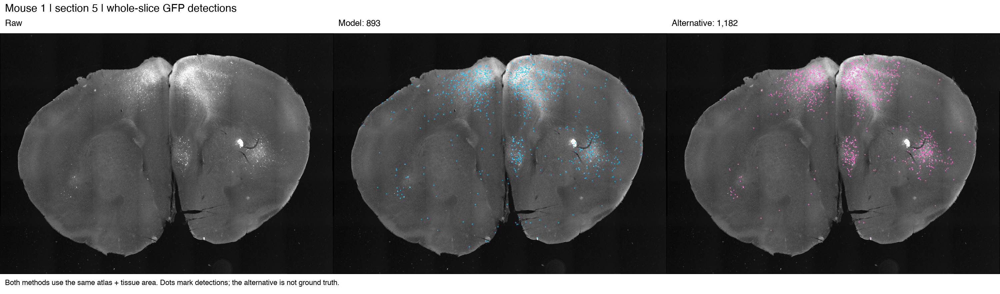
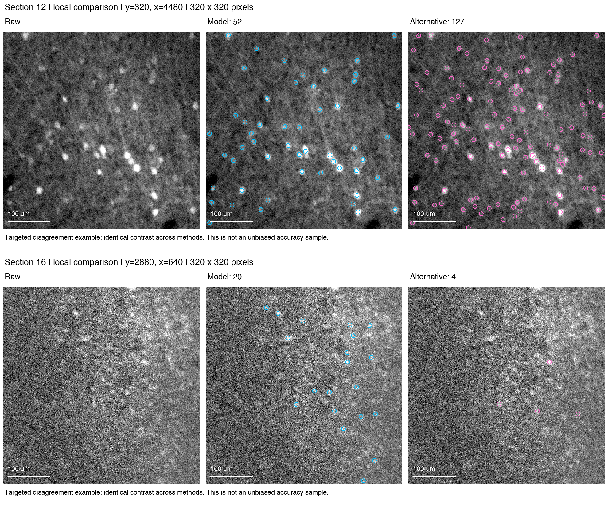
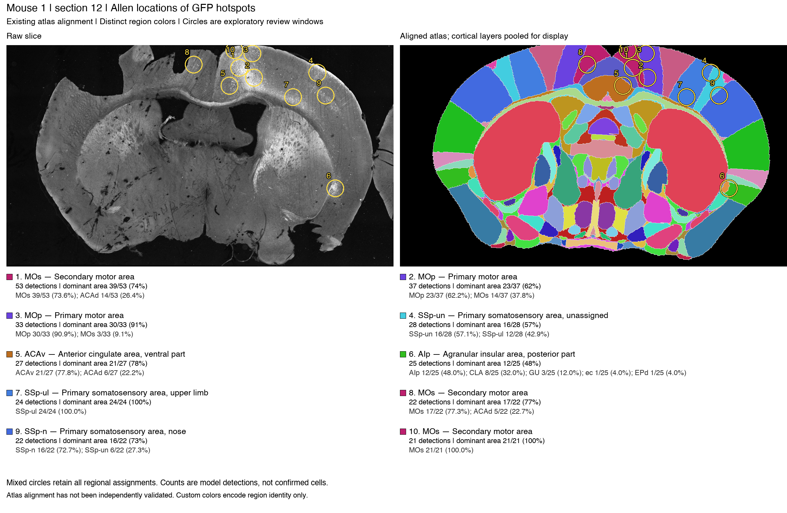
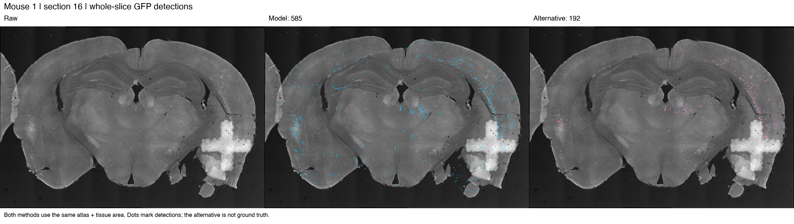
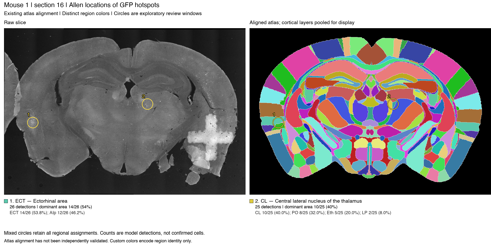

# ACC-Projecting GFP Analysis

Cell detection, whole-slice comparison, and atlas localization of dense GFP-labeled populations in coronal mouse brain sections.

This project examines GFP labeling in an ACC-projecting dataset from the Cichon Lab. A fine-tuned Cellpose ensemble identifies candidate cell bodies, appearance and morphology classifiers filter candidates, and spatial analysis highlights areas containing many detections. The current analysis covers **16 sections from one mouse**.

This repository contains the final detection coordinates, result tables, selected figures, complete review reports, and portable postprocessing code. Raw microscopy images, source label TIFFs, hand-count XMLs, trained weights, and the original training/inference pipeline remain local. It is a saved-results analysis release, not a standalone pretrained detector.

## Whole-slice counting



Mouse 1, section 5, selected for its more intact tissue and clearly visible dense and sparse areas. Both methods are shown over identical images and restricted to the same atlas-and-tissue area: 893 model detections and 1,182 alternative detections. The alternative is a separate counting method, not ground truth. Section 5 was excluded from fitting, but this full-slice display is an application example, not a whole-slice hand-count accuracy test.

Across all 16 sections, with one-to-one matching within **9 µm**:

| Comparison | Detections |
| --- | ---: |
| Current model | 13,430 |
| Alternative | 16,248 |
| Matched between methods | 9,064 |
| Model only | 4,366 |
| Alternative only | 7,184 |

These numbers measure agreement between methods, not biological accuracy. All physical-image detections are retained in the coordinate files; the table uses only the shared comparison area.

## Individual counting areas



The upper example is from section 12; the lower is from section 16. These windows were selected to show large count disagreements in opposite directions. They are targeted review examples, not a random accuracy sample. Each row uses the same contrast across all three panels; scale bars are 100 µm.

## Dense areas and Allen locations



Circles identify review windows with at least **20 detections within a 250 µm radius**. Locations come from the existing aligned Allen label maps supplied with the project; the source masks were not redrawn or replaced. Colors distinguish regions, and cortical layers are pooled into their parent area for display. Exact structure IDs remain in the tables. A circle can span several areas, so the legend reports its composition rather than assigning every detection to one region.

The model yields **150 review circles across 16 sections**, containing 5,477 detections without duplicate membership within a section. These are two-dimensional windows, not 150 distinct anatomical nodes. Detections outside the circles remain available for analysis. The atlas alignment has not been independently validated, and labeling alone does not establish functional connectivity or a psilocybin effect.

<details>
<summary>Another slice: section 16</summary>





</details>

## Model and validation

The working model combines three fine-tuned Cellpose 3 detectors, ExtraTrees morphology filters, and random-feature SVM appearance filters. A detection must survive filtering and have support from at least two detectors within 8 µm. Overlapping-tile duplicates are then removed.

The final fit used **37 development crops with 440 accepted cell marks**, from sections 1, 3, 7, 12, and 13. Type 1 marks represent cells; Type 2 uncertain locations are ignored; Type 3 marks provide explicit non-cell examples. Sections 5 and 9 were excluded from fitting. The final fit used all development crops after section-wise cross-validation, preserving this split.

The repeated held-out check comprises six crops from sections 5 and 9, with 127 hand marks. At the preset 9 µm matching radius:

| Method | Matched | Missed | Unmatched detections | Precision | Recall | F1 |
| --- | ---: | ---: | ---: | ---: | ---: | ---: |
| Previous conservative model | 102 | 25 | 6 | 94.4% | 80.3% | 0.868 |
| Current full model | 115 | 12 | 13 | 89.8% | 90.6% | 0.902 |
| Alternative | 119 | 8 | 178 | 40.1% | 93.7% | 0.561 |

Scores are relative to the retained hand marks; an unmatched detection is not automatically a false cell. These same-mouse test crops had been evaluated previously, and an unjudgeable original crop had been replaced. This is not a new untouched test or an unbiased whole-tissue accuracy estimate.

The current recipe improved development recall and F1 but **failed the original conservative acceptance gate** because unmatched detections and acceptance of explicit negatives increased. It was subsequently selected as a working model for dense-area analysis. The neural-only change with the old filters performed similarly in development, so the added classifier refit is not established as an improvement. No independent-animal validation is available. See [methods and limitations](METHODS.md) for the frozen settings and interpretation.

## Reproduce the saved-result checks

Python 3.9 or newer:

```bash
python3 -m venv .venv
source .venv/bin/activate
python -m pip install -r requirements.txt
python analyze.py
python -m unittest discover -s tests -v
```

`analyze.py` recomputes section totals and spatial agreement from the included coordinates, checks regional totals and densities against the saved areas, verifies membership of the saved circles, and checks validation-score arithmetic. It writes `.local/recomputed_summary.json`. These checks do not rerun detection, validate biological identities, or independently establish the atlas registration.

To rebuild the five gallery images, supply the private source TIFFs under the relative paths in [data/slices.csv](data/slices.csv), then run:

```bash
python make_figures.py --image-root /path/to/private/data
```

The manifest records pixel size, dimensions, display ranges, and SHA-256 hashes. The renderer verifies source hashes and reads the images without modifying them. It requires the section 5, 12, and 16 raw images and their aligned label TIFFs. The PDFs are archived final reports; this command rebuilds the README PNGs only.

## Files and reports

| Location | Contents |
| --- | --- |
| [results/](results/) | Counts, regional comparisons, dense-window membership, atlas assignments, and validation summaries |
| [results/detections/](results/detections/) | Coordinates from both methods, including atlas/tissue inclusion flags |
| [methods/](methods/) | Model recipe, classifier cutoffs, archived inference environment, and source hashes |
| [atlas/](atlas/) | Allen structure ontology and the custom display palette |
| [Whole-slice comparison](reports/whole_slice_comparison.pdf) | All 16 sections: raw, model, alternative |
| [Dense areas](reports/dense_areas.pdf) | Whole-slice density review maps |
| [Allen hotspots](reports/allen_hotspots.pdf) | Anatomical labels and mixed-region compositions |
| [Local disagreements](reports/local_disagreements.pdf) | Selected zoomed counting differences |
| [Hand-count validation](reports/hand_count_validation.pdf) | Raw, hand counts, and model comparisons for six test crops |

`spatial.py` contains the consensus, cross-tile deduplication, point-matching, and circle-membership routines. `atlas.py` resolves structure IDs and pools actual cortical layers for display while retaining hippocampal CA fields separately. `make_figures.py` creates the gallery from source images and saved coordinates.

## Attribution and use

Atlas names and hierarchy come from the [Allen Mouse Brain Atlas structure graph](https://api.brain-map.org/api/v2/structure_graph_download/1.json). Detection uses [Cellpose](https://github.com/MouseLand/cellpose). The atlas display colors in this repository are custom, not the official Allen palette.

Original code and written documentation are available under the [MIT license](LICENSE). Figures, detection coordinates, and other lab-derived results have separate usage restrictions in [NOTICE.md](NOTICE.md). This is a preliminary research analysis of one animal.
